<picture>
  <source media="(prefers-color-scheme: light)" srcset="docs/assets/blocks/hero-light.svg">
  
</picture>

<p align="center">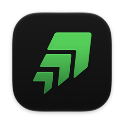</p>

<h1 align="center">Vane</h1>

<p align="center"><b>Tus cifras de App Store Connect, leídas por ti.</b><br>Una app para Mac que descarga tus informes de ventas y analíticas con tu propia clave de API, los guarda en tu Mac y te dice qué ha cambiado.</p>

<p align="center">
  <a href="https://github.com/adrbn/vane/releases/latest"></a>
  <a href="#qué-hace"></a>
  <a href="#privacidad"></a>
  <a href="#compilar-desde-el-código-fuente"></a>
</p>

<p align="center">
  
  <a href="LICENSE"></a>
  <a href="https://github.com/adrbn/vane/releases/latest"></a>
  
  
</p>

<p align="center"><sub>Libre y de código abierto · firmada y notarizada · Apple silicon · app para iPhone en el repositorio</sub></p>

<p align="center"><a href="README.md">English</a> · <a href="README.fr.md">Français</a> · <b>Español</b> · <a href="README.zh-CN.md">简体中文</a></p>

---

Vane es para el desarrollador independiente que abre App Store Connect cada mañana para saber si ayer fue un buen día. Pone todo el embudo en una sola pantalla, de las impresiones a las visitas de la página y a las descargas, mantiene cada cifra en el mismo periodo para que coincidan entre sí, y escribe una observación en lenguaje claro cuando algo se mueve: una caída de la tasa de clics tras una actualización, una palabra clave que repite el nombre de la app, un país que despega.

> Vane lee lo que Apple publica, nada más. Las analíticas de Apple llegan con uno o dos días de retraso, así que los días más recientes aparecen primero en Sales.

La interfaz de la app está en inglés; los nombres de pantallas de abajo son los que verás.

## Qué hace

<table>
  <tr>
    <td>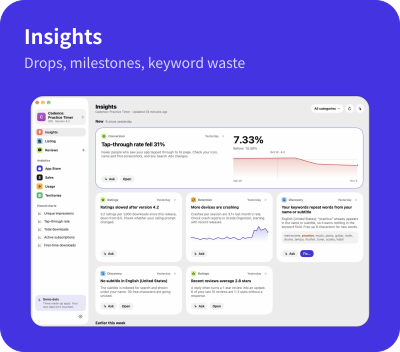</td>
    <td>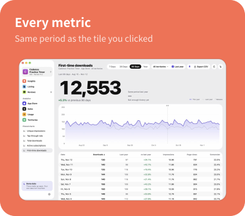</td>
    <td>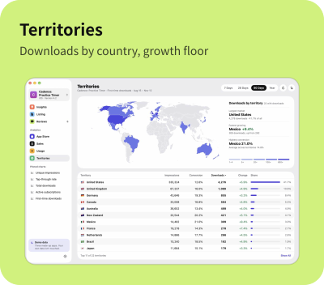</td>
  </tr>
  <tr>
    <td>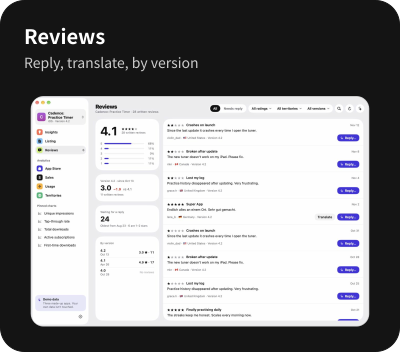</td>
    <td>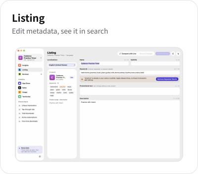</td>
    <td>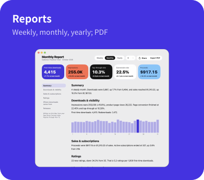</td>
  </tr>
</table>

<sub>Las imágenes de las tarjetas están en inglés. Todas son capturas reales de Vane en modo demostración: tres apps inventadas, ningún dato real.</sub>

## Cuatro temas

La misma app, las mismas cifras. Elige uno en los ajustes; cada tema mantiene su propio modo claro u oscuro.

<table>
  <tr>
    <td>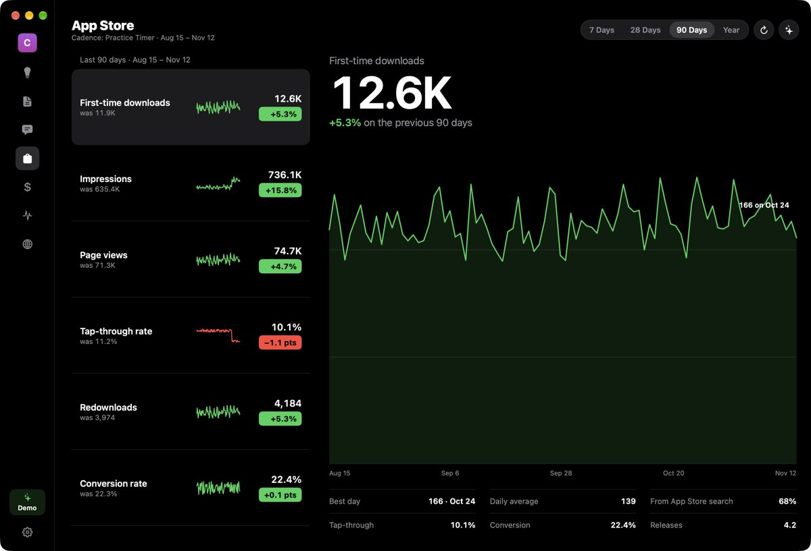<br><sub><b>Ticker</b>: negro, un solo verde, una lista de teletipo bursátil</sub></td>
    <td>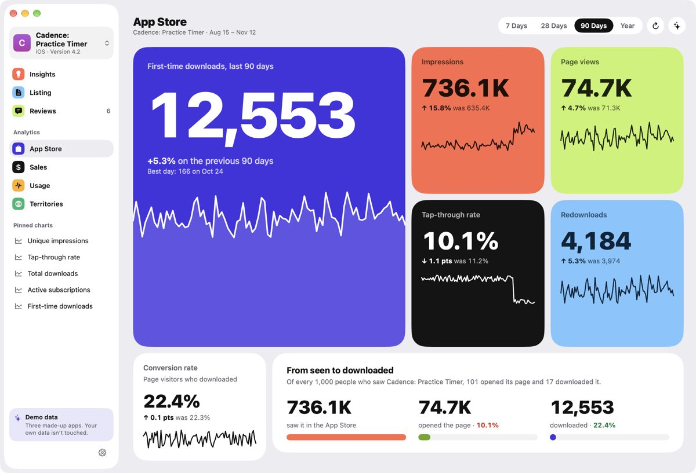<br><sub><b>Color Blocks</b>: bloques de color planos, cifras grandes</sub></td>
  </tr>
  <tr>
    <td>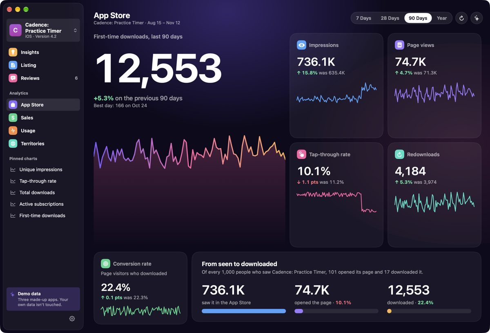<br><sub><b>Nocturne</b>: cristal violeta profundo</sub></td>
    <td>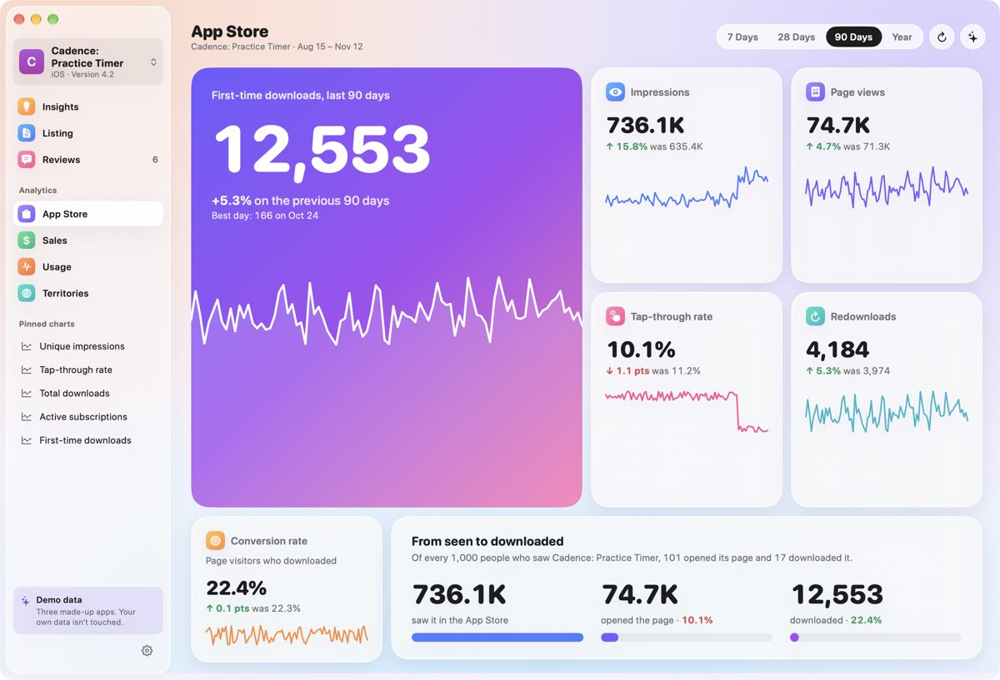<br><sub><b>Candy Glass</b>: degradados suaves, tipografía redondeada</sub></td>
  </tr>
</table>

## Funciones

**Panel y métricas**
- Pantalla App Store: primeras descargas, impresiones, visitas de la página, tasa de clics, redescargas, conversión y un embudo visto → abierto → descargado.
- Cada mosaico abre su métrica en el mismo periodo (7, 28, 90 días o un año) y con la misma fecha final, así que las dos cifras coinciden.
- Gráficos diarios hasta 90 días, semanas completas en un año. Un periodo incompleto nunca se dibuja como una caída.
- Ventas por mes o por semana con las versiones marcadas, Usage (sesiones, cierres inesperados, valoraciones, suscripciones), exportación CSV.
- Territories: mapa del mundo y tabla de primeras descargas por país.

**Insights**
- Caídas e hitos medidos frente a tu rango habitual (del percentil 10 al 90 de los 63 días anteriores).
- Revisión de palabras clave: palabras que ya están en el nombre o el subtítulo, subtítulo ausente, con una corrección en un clic.
- Actualización en segundo plano, con una notificación opcional cuando hay algo nuevo.

**Ficha y reseñas**
- Edita el nombre, el subtítulo, las palabras clave, el texto promocional y la descripción de cada idioma. El envío solo manda lo que ha cambiado.
- Una vista previa «In search» con tu icono, nombre, subtítulo y palabras clave.
- Reseñas por valoración, país y versión. Responde ahí mismo. Traducción en el Mac cuando el idioma está instalado.

**Informes y asistente**
- Informes semanales, mensuales y anuales redactados a partir de tus cifras. Compártelos como texto o expórtalos en PDF.
- Chat opcional sobre tus cifras a través de Claude Code o Codex en la línea de comandos, si ya los tienes en tu Mac.

## Conseguirla

1. Descarga **Vane** desde [Releases](https://github.com/adrbn/vane/releases/latest). Está firmada y notarizada por Apple.
2. Arrástrala a Aplicaciones y ábrela. Puedes explorarla primero con los datos de demostración.
3. En App Store Connect, abre Usuarios y acceso → Integraciones → [API de App Store Connect](https://appstoreconnect.apple.com/access/integrations/api) y crea una clave.
4. Suelta el archivo `.p8` en el formulario de conexión de Vane, con el Issuer ID, el Key ID y tu número de proveedor (en [Pagos e informes financieros](https://appstoreconnect.apple.com/itc/payments_and_financial_reports)).

El historial de ventas llega enseguida. Las analíticas de Apple siguen en uno o dos días.

## Requisitos

- macOS 26 o posterior en Apple silicon.
- Una clave de API de App Store Connect que pueda leer ventas e informes. Editar la ficha y responder a reseñas requieren una clave cuyo rol lo permita.

## Privacidad

- Tu clave se guarda en el llavero de macOS. Tus informes viven en una base de datos local en tu Mac.
- Vane se conecta a tres sitios: `api.appstoreconnect.apple.com` para tus informes, `itunes.apple.com` para los iconos de las apps y el Banco Central Europeo para los tipos de cambio del día. Sin cuenta, sin servidor, sin analíticas.
- El asistente está apagado hasta que lo usas. Ejecuta tu propia herramienta de línea de comandos, que envía tu pregunta y las cifras en pantalla al proveedor de esa herramienta.

## Compilar desde el código fuente

```bash
git clone https://github.com/adrbn/vane.git && cd vane
swift test
scripts/bundle.sh release    # genera build/Vane.app
```

Necesita Xcode 26. La app para iPhone está en `ios/` (`cd ios && xcodegen generate`); todavía usa el diseño anterior. Las imágenes del README se generan a partir de capturas reales: `python3 docs/assets/make_svgs.py blocks`.

El código sigue diciendo Almanac, el primer nombre de la app. El identificador `dev.almanac.app` se mantuvo para conservar los datos existentes.

## Apoyar

Si Vane te ahorra la visita matinal a App Store Connect, un café ayuda a que siga adelante.

<a href="https://ko-fi.com/adrbn"></a>

Una estrella en el repositorio también ayuda.

## Licencia

MIT. Úsala, modifícala, distribúyela; conserva el aviso de copyright.

## Créditos

Datos de la API de App Store Connect de Apple y de la búsqueda pública de iTunes. Tipos de cambio del Banco Central Europeo.

<sub>Vane no está afiliada a Apple. App Store y App Store Connect son marcas de Apple Inc.</sub>
