<picture>
  <source media="(prefers-color-scheme: light)" srcset="docs/assets/blocks/hero-light.svg">
  
</picture>

<p align="center"></p>

<h1 align="center">Vane</h1>

<p align="center"><b>Vos chiffres App Store Connect, lus pour vous.</b><br>Une app Mac qui récupère vos rapports de ventes et d'analytics avec votre propre clé d'API, les garde sur votre Mac et vous dit ce qui a changé.</p>

<p align="center">
  <a href="https://github.com/adrbn/vane/releases/latest"></a>
  <a href="#ce-quelle-fait"></a>
  <a href="#confidentialité"></a>
  <a href="#compiler-depuis-les-sources"></a>
</p>

<p align="center">
  
  <a href="LICENSE"></a>
  <a href="https://github.com/adrbn/vane/releases/latest"></a>
  
  
</p>

<p align="center"><sub>Libre et open source · signée et notarisée · Apple silicon · app iPhone dans le dépôt</sub></p>

<p align="center"><a href="README.md">English</a> · <b>Français</b> · <a href="README.es.md">Español</a> · <a href="README.zh-CN.md">简体中文</a></p>

---

Vane s'adresse au développeur indépendant qui ouvre App Store Connect chaque matin pour savoir si la veille a été bonne. Elle met tout l'entonnoir sur un seul écran, des impressions aux visites de la page puis aux téléchargements, garde chaque chiffre sur la même période pour qu'ils concordent, et écrit une remarque en clair quand quelque chose bouge : un taux de clic qui chute après une mise à jour, un mot-clé qui répète le nom de l'app, un pays qui décolle.

> Vane lit ce qu'Apple publie, rien de plus. Les analytics d'Apple arrivent avec un à deux jours de retard, donc les jours les plus récents apparaissent d'abord dans Sales.

L'interface de l'app est en anglais ; les noms d'écrans ci-dessous sont ceux que vous verrez.

## Ce qu'elle fait

<table>
  <tr>
    <td>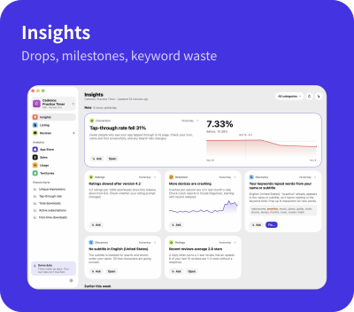</td>
    <td>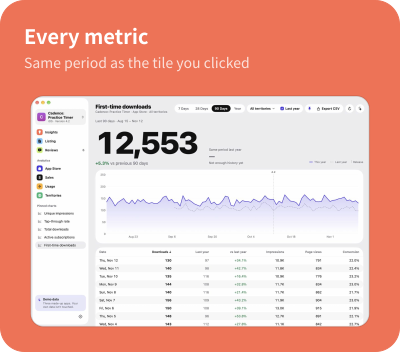</td>
    <td>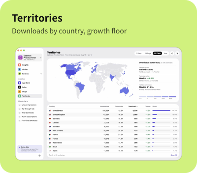</td>
  </tr>
  <tr>
    <td>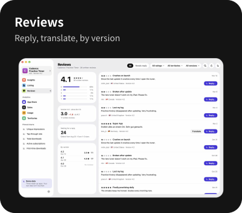</td>
    <td>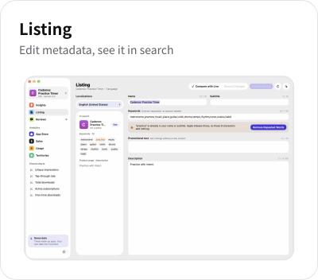</td>
    <td>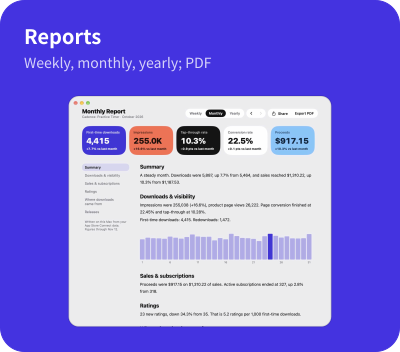</td>
  </tr>
</table>

<sub>Les images de cartes sont en anglais. Toutes sont de vraies captures de Vane en mode démo : trois apps inventées, aucune donnée réelle.</sub>

## Quatre thèmes

Même app, mêmes chiffres. Vous choisissez dans les réglages ; chaque thème garde son propre mode clair ou sombre.

<table>
  <tr>
    <td>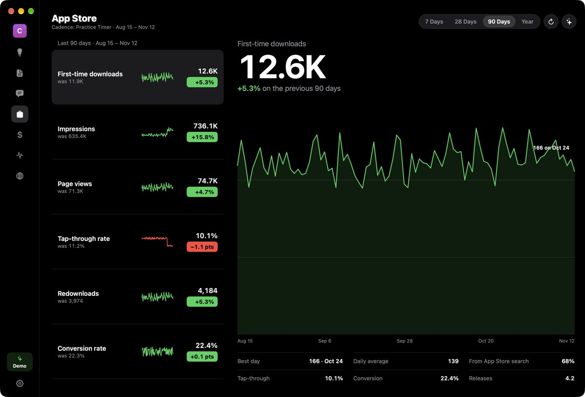<br><sub><b>Ticker</b> : noir, un seul vert, une liste façon téléscripteur boursier</sub></td>
    <td>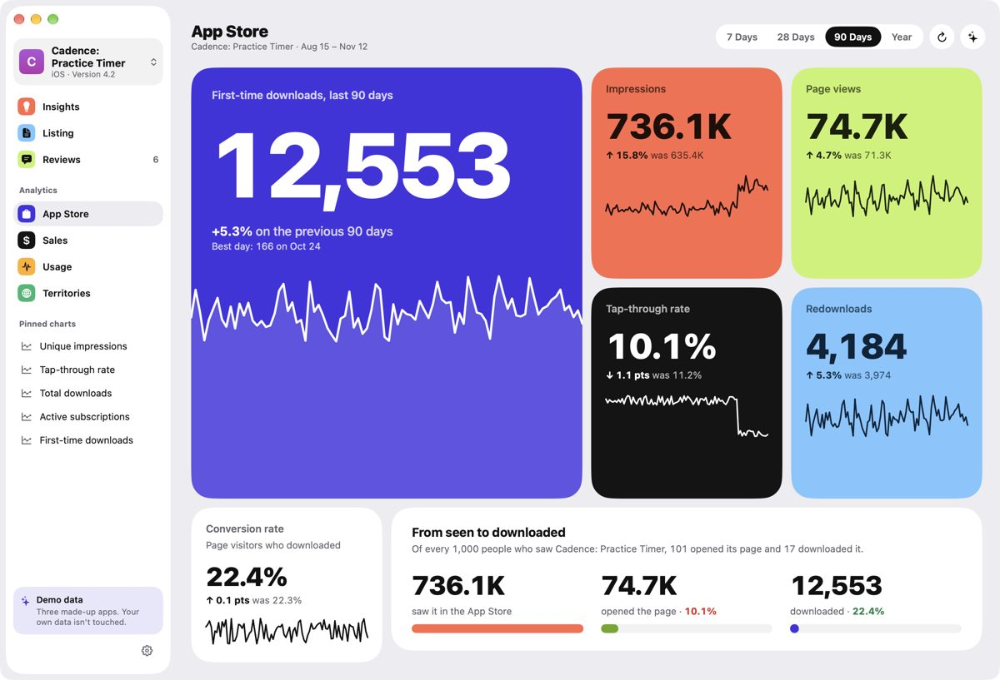<br><sub><b>Color Blocks</b> : aplats de couleur, grands chiffres</sub></td>
  </tr>
  <tr>
    <td>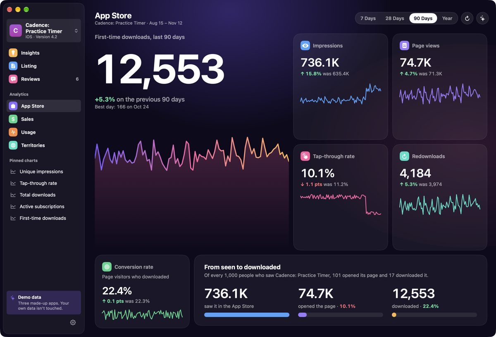<br><sub><b>Nocturne</b> : verre violet profond</sub></td>
    <td>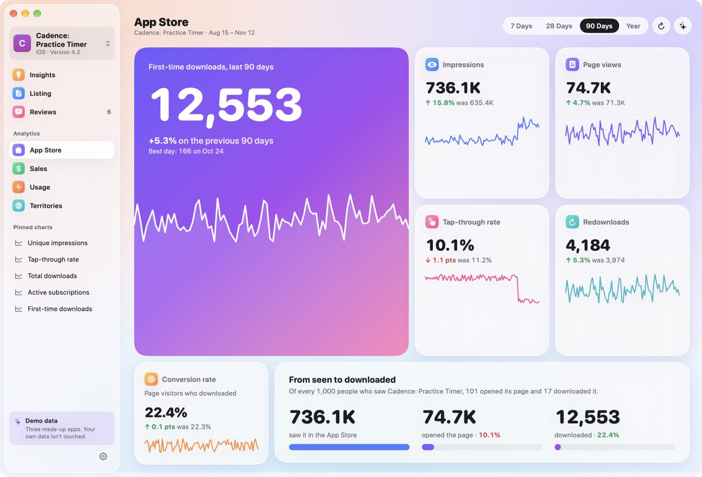<br><sub><b>Candy Glass</b> : dégradés doux, typo arrondie</sub></td>
  </tr>
</table>

## Fonctionnalités

**Tableau de bord et métriques**
- Écran App Store : premiers téléchargements, impressions, visites de la page, taux de clic, retéléchargements, conversion, et un entonnoir vu → ouvert → téléchargé.
- Chaque tuile ouvre sa métrique sur la même période (7, 28, 90 jours ou un an) et la même date de fin, donc les deux chiffres concordent.
- Graphiques quotidiens jusqu'à 90 jours, semaines complètes sur un an. Une période incomplète n'est jamais dessinée comme une chute.
- Ventes par mois ou par semaine avec les mises à jour repérées, Usage (sessions, plantages, notes, abonnements), export CSV.
- Territories : carte du monde et tableau des premiers téléchargements par pays.
- Toutes les apps, ou un groupe que vous créez : chaque écran en fait le total.
- Événements : ajoutez une campagne, une promo ou un post, il apparaît sur les graphiques à côté des mises à jour.

**Insights**
- Chutes et paliers mesurés par rapport à votre fourchette habituelle (du 10ᵉ au 90ᵉ centile des 63 jours précédents).
- Vérification des mots-clés : mots déjà présents dans le nom ou le sous-titre, sous-titre manquant, avec une correction en un clic.
- Les paliers de téléchargements tracent votre cumul qui franchit la ligne, et le temps qu'il faut pour le suivant à votre rythme actuel.
- Actualisation en arrière-plan, avec une notification facultative quand il y a du nouveau, une notification quotidienne des chiffres, et la mise en sourdine par type d'insight.

**Fiche et avis**
- Modifiez le nom, le sous-titre, les mots-clés, le texte promotionnel et la description pour chaque langue. L'envoi ne transmet que ce qui a changé.
- Un aperçu « In search » avec votre icône, votre nom, votre sous-titre et vos mots-clés.
- Avis par note, par pays et par version. Réponse sur place. Traduction sur le Mac quand la langue est installée.

**Rapports et assistant**
- Rapports hebdomadaires, mensuels et annuels rédigés à partir de vos chiffres. Partage en texte ou export PDF.
- Discussion facultative sur vos chiffres via Claude Code ou Codex en ligne de commande, déjà installés sur votre Mac. Il peut consulter n'importe quel chiffre synchronisé (en lecture seule), connaît vos événements et répond dans votre langue.
- Interface en 10 langues, au choix dans les Réglages.

## L'obtenir

1. Téléchargez **Vane** depuis les [Releases](https://github.com/adrbn/vane/releases/latest). Elle est signée et notarisée par Apple.
2. Glissez-la dans Applications et ouvrez-la. Vous pouvez d'abord explorer avec les données de démo.
3. Dans App Store Connect, ouvrez Utilisateurs et accès → Intégrations → [API App Store Connect](https://appstoreconnect.apple.com/access/integrations/api) et créez une clé.
4. Déposez le fichier `.p8` sur le formulaire de connexion de Vane, avec l'Issuer ID, le Key ID et votre numéro de fournisseur (dans [Paiements et rapports financiers](https://appstoreconnect.apple.com/itc/payments_and_financial_reports)).

L'historique des ventes arrive tout de suite. Les analytics d'Apple suivent sous un à deux jours.

Vane vérifie les mises à jour une fois par jour et les installe avec votre accord (Vane → Rechercher les mises à jour…).

## Configuration requise

- macOS 26 ou plus récent, sur Apple silicon.
- Une clé d'API App Store Connect qui peut lire les ventes et les rapports. Modifier votre fiche et répondre aux avis demandent une clé dont le rôle le permet.
- Apple ne laisse qu'une clé Admin activer les rapports d'analytics, une fois par app. Si la vôtre ne le peut pas, Vane propose d'utiliser une clé Admin une seule fois (envoyée, puis oubliée) ou copie un message tout prêt pour votre admin.

## Vos données dans Claude (MCP)

Vane inclut un serveur [MCP](https://modelcontextprotocol.io) en lecture seule : Claude Code, Claude Desktop ou tout client MCP peut interroger tout ce que Vane a synchronisé, métriques quotidiennes par pays, versions, avis, fiches et insights. Il ouvre la base en lecture seule et ne voit jamais votre clé.

```bash
claude mcp add -s user vane /Applications/Vane.app/Contents/MacOS/vane-mcp
```

Pour Claude Desktop, ajoutez `"vane": { "command": "/Applications/Vane.app/Contents/MacOS/vane-mcp" }` sous `mcpServers` dans `claude_desktop_config.json`. Demandez ensuite par exemple « quels pays convertissent le mieux sur 3 mois ? ».

## Confidentialité

- Votre clé est gardée dans le trousseau macOS. Vos rapports vivent dans une base de données locale sur votre Mac.
- Vane contacte quatre endroits : `api.appstoreconnect.apple.com` pour vos rapports, `itunes.apple.com` pour les icônes des apps, la Banque centrale européenne pour les taux de change du jour, et GitHub pour les mises à jour. Pas de compte, pas de serveur, pas d'analytics.
- L'assistant reste éteint tant que vous ne vous en servez pas. Il lance votre propre outil en ligne de commande, qui envoie votre question, les chiffres affichés et ceux qu'il consulte dans vos données Vane (en lecture seule) au fournisseur de cet outil.

## Compiler depuis les sources

```bash
git clone https://github.com/adrbn/vane.git && cd vane
swift test
scripts/bundle.sh release    # produit build/Vane.app
```

Il faut Xcode 26. L'app iPhone se trouve dans `ios/` (`cd ios && xcodegen generate`), avec les quatre mêmes looks et des widgets pour l'écran d'accueil et l'écran verrouillé. Les images du README sont générées à partir de vraies captures : `python3 docs/assets/make_svgs.py blocks`.

Le code dit encore Almanac, le premier nom de l'app. L'identifiant `dev.almanac.app` est resté pour que les données existantes suivent.

## Soutenir

Si Vane vous épargne un passage matinal dans App Store Connect, un café l'aide à continuer.

<a href="https://ko-fi.com/adrbn"></a>

Une étoile sur le dépôt aide aussi.

## Licence

MIT. Utilisez-la, modifiez-la, distribuez-la ; gardez la mention de copyright.

## Crédits

Données issues de l'API App Store Connect d'Apple et de la recherche publique iTunes. Taux de change de la Banque centrale européenne.

<sub>Vane n'est pas affiliée à Apple. App Store et App Store Connect sont des marques d'Apple Inc.</sub>
