<picture>
  <source media="(prefers-color-scheme: light)" srcset="docs/assets/blocks/hero-light.svg">
  
</picture>

<p align="center"></p>

<h1 align="center">Vane</h1>

<p align="center"><b>Your App Store Connect numbers, read for you.</b><br>A Mac app that pulls your sales and analytics reports with your own API key, keeps them on your Mac, and tells you what changed.</p>

<p align="center">
  <a href="https://github.com/adrbn/vane/releases/latest"></a>
  <a href="#what-it-does"></a>
  <a href="#privacy"></a>
  <a href="#build-from-source"></a>
</p>

<p align="center">
  
  <a href="LICENSE"></a>
  <a href="https://github.com/adrbn/vane/releases/latest"></a>
  
  
</p>

<p align="center"><sub>Free and open source · signed and notarized · Apple silicon · iPhone companion in the repo</sub></p>

<p align="center"><b>English</b> · <a href="README.fr.md">Français</a> · <a href="README.es.md">Español</a> · <a href="README.zh-CN.md">简体中文</a></p>

---

Vane is for the indie developer who opens App Store Connect every morning to find out whether yesterday was good. It puts the whole funnel on one screen, from impressions to page views to downloads, keeps every number on the same period so they agree with each other, and writes a plain-language insight when something moves: a tap-through drop after a release, a keyword that repeats your app's name, a country that took off.

> Vane reads what Apple publishes, nothing more. Apple's analytics arrive one to two days late, so the freshest days show up in Sales first.

## What it does

<table>
  <tr>
    <td>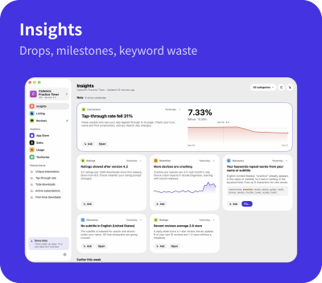</td>
    <td>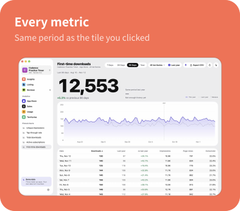</td>
    <td>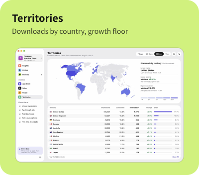</td>
  </tr>
  <tr>
    <td>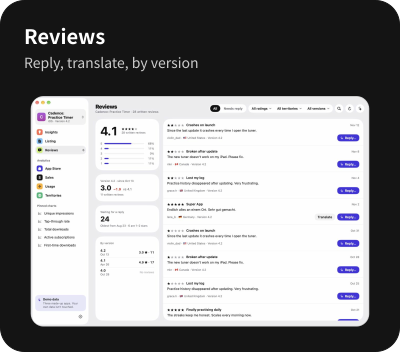</td>
    <td>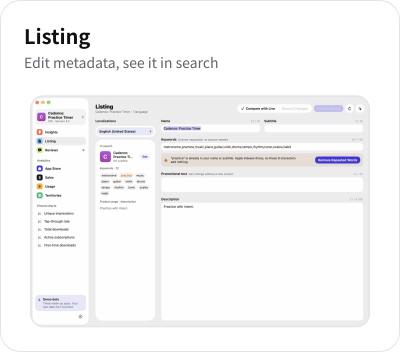</td>
    <td>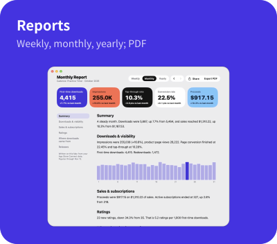</td>
  </tr>
</table>

<sub>Every image is a real capture of Vane running its built-in demo: three made-up apps, no real data.</sub>

## Four looks

Same app, same numbers. Pick one in Settings; each keeps its own light or dark scheme.

<table>
  <tr>
    <td>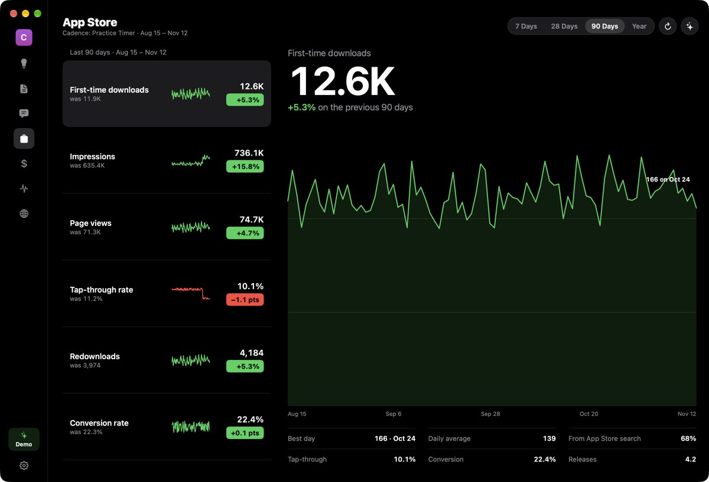<br><sub><b>Ticker</b>: black, one green, a stock-ticker list</sub></td>
    <td>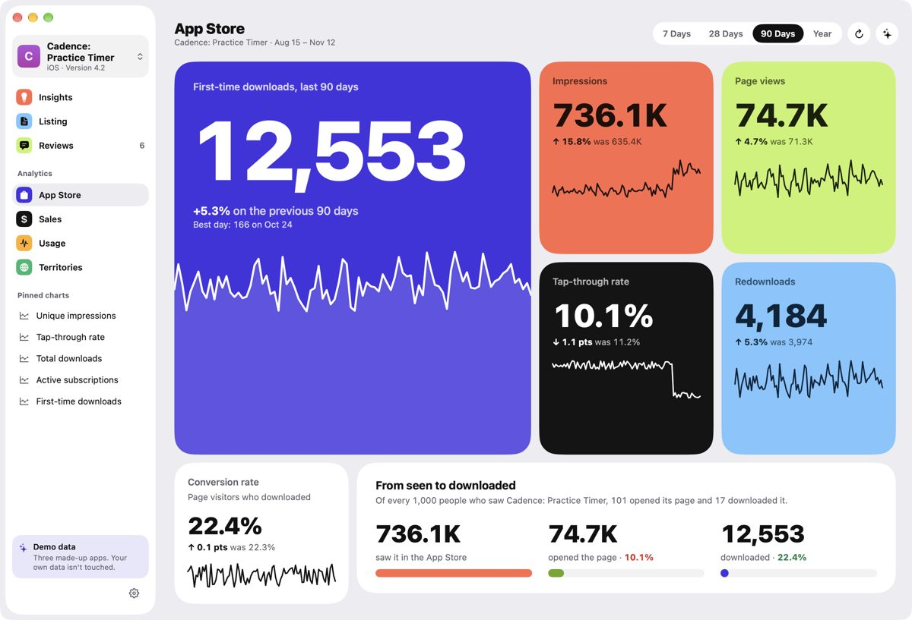<br><sub><b>Color Blocks</b>: flat tiles, big numbers</sub></td>
  </tr>
  <tr>
    <td>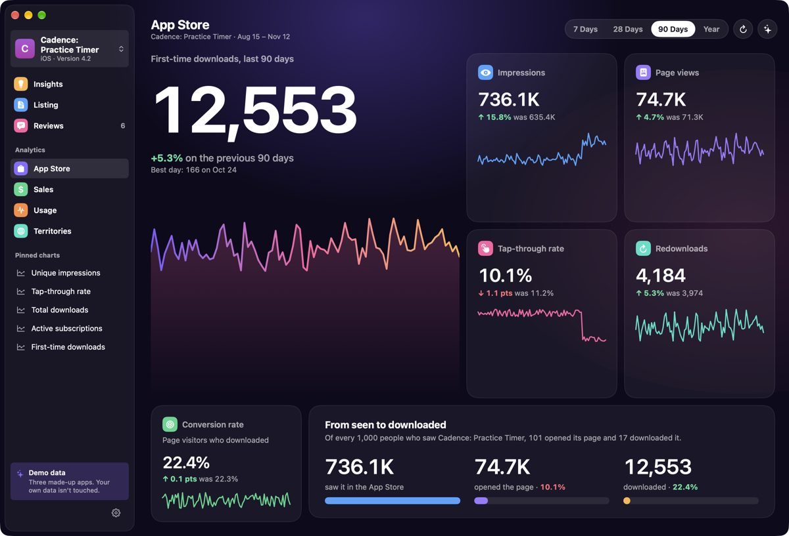<br><sub><b>Nocturne</b>: deep violet glass</sub></td>
    <td>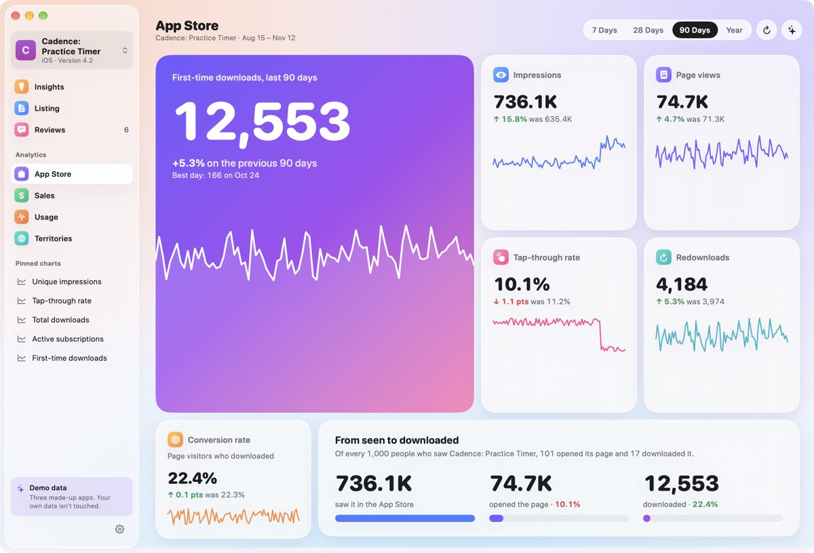<br><sub><b>Candy Glass</b>: soft gradients, rounded type</sub></td>
  </tr>
</table>

## Features

**Dashboard and metrics**
- App Store screen: first-time downloads, impressions, page views, tap-through rate, redownloads, conversion, and a seen → opened → downloaded funnel.
- Every tile opens its metric on the same period (7, 28, 90 days or a year) and the same end date, so the two numbers match.
- Daily charts up to 90 days, complete weeks for a year. Partial periods are never drawn as a drop.
- Sales by month or week with release markers, Usage (sessions, crashes, ratings, subscriptions), CSV export.
- Territories: world map and table of first-time downloads by country.

**Insights**
- Drops and milestones measured against your usual range (10th to 90th percentile of the previous 63 days).
- Keyword checks: words already in your name or subtitle, a missing subtitle, with a one-click fix.
- Background refresh, with an optional notification when there's something new.

**Listing and reviews**
- Edit name, subtitle, keywords, promotional text and description per language. Upload sends only what changed.
- An "In search" preview with your icon, name, subtitle and keyword chips.
- Reviews by rating, country and version. Reply in place. Translation on the Mac when the language is installed.

**Reports and assistant**
- Weekly, monthly and yearly reports written from your numbers. Share as text or export a PDF.
- Optional chat about your numbers through the Claude Code or Codex command line already on your Mac.

## Get it

1. Download **Vane** from [Releases](https://github.com/adrbn/vane/releases/latest). It's signed and notarized by Apple.
2. Drag it to Applications and open it. You can look around with demo data first.
3. In App Store Connect, open Users and Access → Integrations → [App Store Connect API](https://appstoreconnect.apple.com/access/integrations/api) and create a key.
4. Drop the `.p8` file on Vane's connect form, with the Issuer ID, the Key ID and your vendor number (from [Payments and Financial Reports](https://appstoreconnect.apple.com/itc/payments_and_financial_reports)).

Sales history arrives right away. Apple's analytics follow in one to two days.

## Requirements

- macOS 26 or later on Apple silicon.
- An App Store Connect API key that can read Sales and Reports. Editing your listing and replying to reviews need a key whose role allows it.

## Privacy

- Your key is kept in the macOS Keychain. Your reports live in a local database on your Mac.
- Vane talks to three places: `api.appstoreconnect.apple.com` for your reports, `itunes.apple.com` for app icons, and the European Central Bank for daily exchange rates. No account, no server, no analytics.
- The assistant is off until you use it. It runs your own command-line tool, which sends your question and the numbers on screen to that tool's provider.

## Build from source

```bash
git clone https://github.com/adrbn/vane.git && cd vane
swift test
scripts/bundle.sh release    # builds build/Vane.app
```

Needs Xcode 26. The iPhone companion lives in `ios/` (`cd ios && xcodegen generate`), with the same four looks and Home and Lock Screen widgets. The README art is generated from real captures: `python3 docs/assets/make_svgs.py blocks`.

The code still says Almanac, the app's first name. The bundle identifier stayed `dev.almanac.app` so existing data carries over.

## Support

If Vane saves you a morning trip to App Store Connect, a coffee keeps it going.

<a href="https://ko-fi.com/adrbn"></a>

A star on the repo helps too.

## License

MIT. Use it, change it, ship it; keep the copyright notice.

## Credits

Data from Apple's App Store Connect API and the public iTunes lookup. Exchange rates from the European Central Bank.

<sub>Vane is not affiliated with Apple. App Store and App Store Connect are trademarks of Apple Inc.</sub>
