<picture>
  <source media="(prefers-color-scheme: light)" srcset="docs/assets/blocks/hero-light.svg">
  
</picture>

<h1 align="center">Vane</h1>

<p align="center"><b>你的 App Store Connect 数据，替你读懂。</b><br>一款 Mac App：用你自己的 API 密钥拉取销售和分析报告，数据只存在你的 Mac 上，并告诉你哪些地方变了。</p>

<p align="center">
  <a href="https://github.com/adrbn/vane/releases/latest"></a>
  <a href="#功能"></a>
  <a href="#隐私"></a>
  <a href="#从源代码构建"></a>
</p>

<p align="center">
  
  <a href="LICENSE"></a>
  <a href="https://github.com/adrbn/vane/releases/latest"></a>
  
  
</p>

<p align="center"><sub>免费开源 · 已签名并经过公证 · Apple 芯片 · 仓库内附 iPhone App</sub></p>

<p align="center"><a href="README.md">English</a> · <a href="README.fr.md">Français</a> · <a href="README.es.md">Español</a> · <b>简体中文</b></p>

---

Vane 写给每天早上打开 App Store Connect、想知道昨天表现好不好的独立开发者。它把整个转化漏斗放在一个界面上，从展示到产品页浏览再到下载；所有数字都按同一时段计算，彼此对得上；数据有明显变化时，它会用平实的语言写一条洞察：更新后点击率下降、关键词重复了 App 名称、某个国家突然起量。

> Vane 只读取 Apple 发布的数据。Apple 的分析数据会晚一到两天，所以最新几天会先出现在 Sales 里。

App 界面为英文，下文中的界面名称与 App 内一致。

## 功能

<table>
  <tr>
    <td>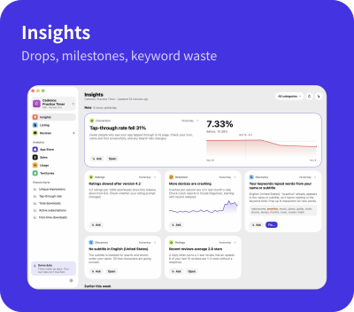</td>
    <td>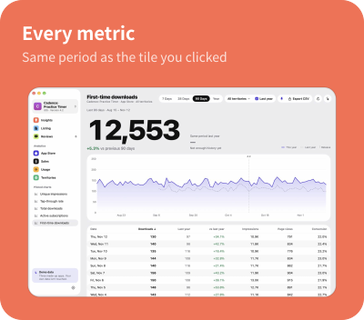</td>
    <td>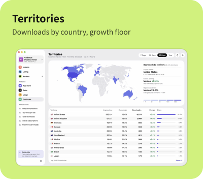</td>
  </tr>
  <tr>
    <td>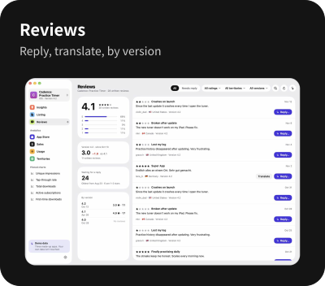</td>
    <td>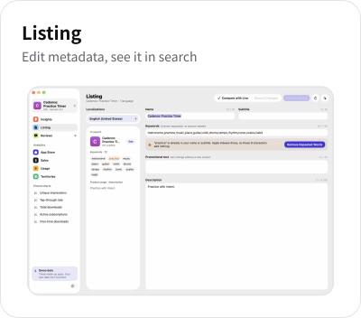</td>
    <td>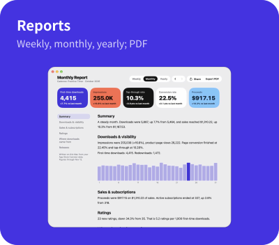</td>
  </tr>
</table>

<sub>卡片图片为英文。所有图片都是 Vane 内置演示模式的真实截图：三款虚构的 App，没有任何真实数据。</sub>

## 四种外观

同一个 App，同样的数字。在设置中选择；每种外观都有自己固定的浅色或深色模式。

<table>
  <tr>
    <td>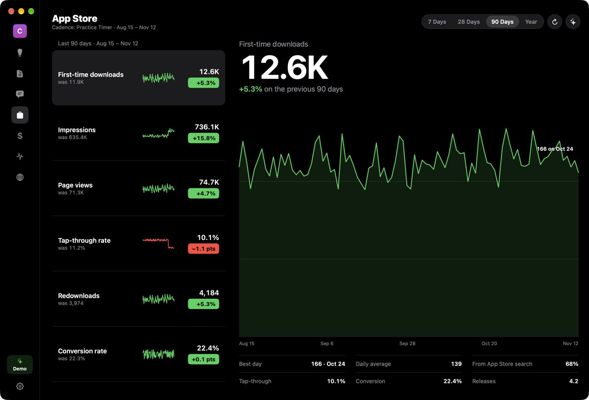<br><sub><b>Ticker</b>：黑底、单一绿色、股票行情式列表</sub></td>
    <td>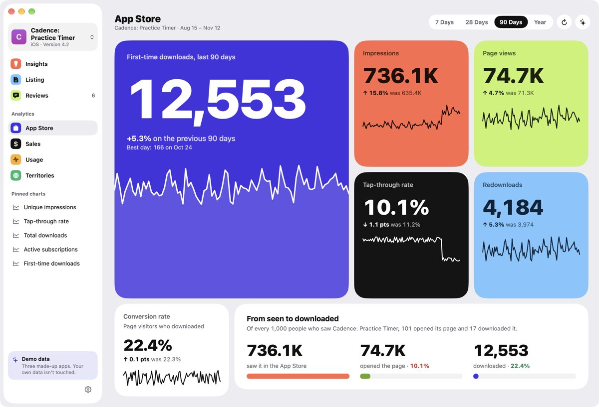<br><sub><b>Color Blocks</b>：纯色色块，大号数字</sub></td>
  </tr>
  <tr>
    <td>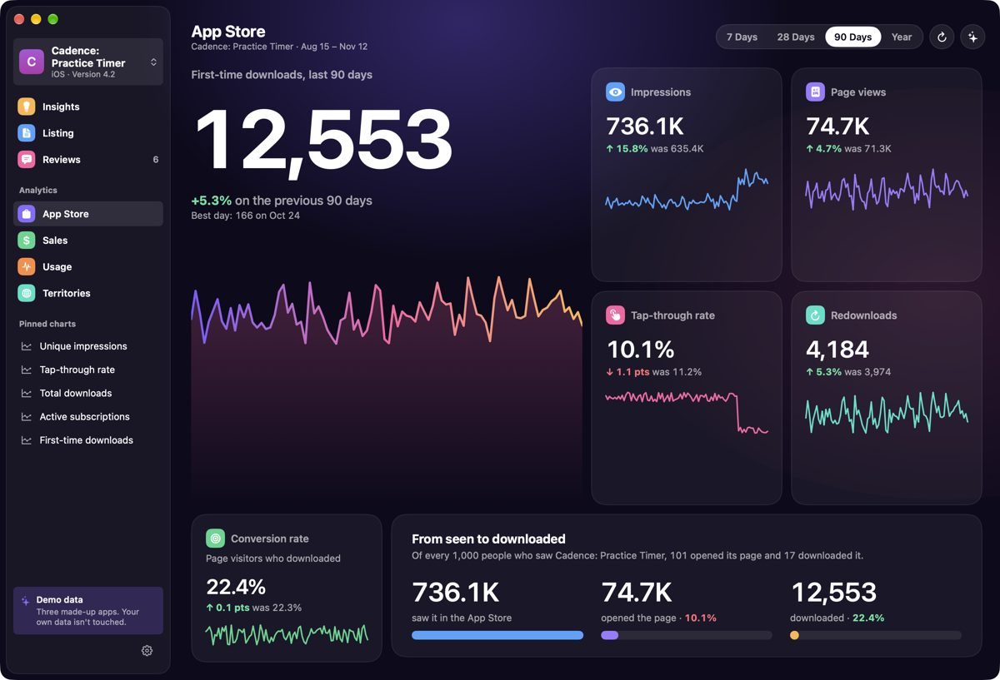<br><sub><b>Nocturne</b>：深紫色玻璃质感</sub></td>
    <td>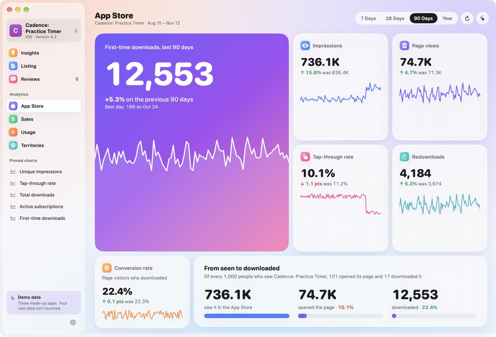<br><sub><b>Candy Glass</b>：柔和渐变，圆体字</sub></td>
  </tr>
</table>

## 特性

**仪表盘与指标**
- App Store 界面：首次下载、展示次数、产品页浏览、点击率、重新下载、转化率，以及“看到 → 打开 → 下载”漏斗。
- 每个磁贴都会按相同时段（7 天、28 天、90 天或一年）和相同截止日期打开对应指标，所以两边的数字一致。
- 90 天以内按天显示，一年按完整周显示。不完整的时段绝不会画成下跌。
- 按月或按周查看销售，标注版本发布；Usage（会话、崩溃、评分、订阅）；导出 CSV。
- Territories：按国家统计首次下载的世界地图和表格。

**Insights**
- 下跌和里程碑以你的常规区间为参照（前 63 天的第 10 至第 90 百分位）。
- 关键词检查：名称或副标题中已有的词、缺少副标题，一键修复。
- 后台刷新，有新内容时可选发送通知。

**商品页与评论**
- 按语言编辑名称、副标题、关键词、推广文本和描述。上传时只发送改动的部分。
- “In search”预览：显示你的图标、名称、副标题和关键词。
- 按评分、国家和版本查看评论。直接在 App 内回复。已安装对应语言时在 Mac 上本地翻译。

**报告与助手**
- 根据你的数据生成周报、月报和年报。可作为文本分享或导出 PDF。
- 可选：通过 Mac 上已安装的 Claude Code 或 Codex 命令行，就你的数据进行对话。

## 获取

1. 从 [Releases](https://github.com/adrbn/vane/releases/latest) 下载 **Vane**。它已由 Apple 签名并公证。
2. 拖到“应用程序”文件夹后打开。可以先用演示数据随便看看。
3. 在 App Store Connect 中打开“用户和访问”→“集成”→[App Store Connect API](https://appstoreconnect.apple.com/access/integrations/api)，创建一个密钥。
4. 把 `.p8` 文件拖到 Vane 的连接表单上，并填写 Issuer ID、Key ID 和你的供应商编号（在[付款和财务报告](https://appstoreconnect.apple.com/itc/payments_and_financial_reports)中）。

销售历史会立即到达。Apple 的分析数据会在一到两天后跟上。

## 系统要求

- 搭载 Apple 芯片的 Mac，macOS 26 或更高版本。
- 一个可读取销售和报告的 App Store Connect API 密钥。编辑商品页和回复评论需要具备相应权限角色的密钥。

## 隐私

- 你的密钥保存在 macOS 钥匙串中。你的报告存放在 Mac 上的本地数据库里。
- Vane 只连接三个地方：`api.appstoreconnect.apple.com` 获取你的报告，`itunes.apple.com` 获取 App 图标，欧洲中央银行获取每日汇率。没有账号，没有服务器，没有统计分析。
- 助手在你使用之前一直关闭。它运行你自己的命令行工具，该工具会把你的问题和屏幕上的数字发送给它的服务提供方。

## 从源代码构建

```bash
git clone https://github.com/adrbn/vane.git && cd vane
swift test
scripts/bundle.sh release    # 生成 build/Vane.app
```

需要 Xcode 26。iPhone App 位于 `ios/`（`cd ios && xcodegen generate`），目前仍是旧版设计。README 中的图片由真实截图生成：`python3 docs/assets/make_svgs.py blocks`。

代码里仍叫 Almanac，这是 App 最初的名字。Bundle ID `dev.almanac.app` 保持不变，以便沿用已有数据。

## 支持

如果 Vane 帮你省去了每天早上去 App Store Connect 的那一趟，请我喝杯咖啡，让它继续下去。

<a href="https://ko-fi.com/adrbn"></a>

给仓库点个星也很有帮助。

## 许可证

MIT。可以使用、修改、发布；请保留版权声明。

## 致谢

数据来自 Apple 的 App Store Connect API 和公开的 iTunes 查询接口。汇率来自欧洲中央银行。

<sub>Vane 与 Apple 无关联。App Store 和 App Store Connect 是 Apple Inc. 的商标。</sub>
